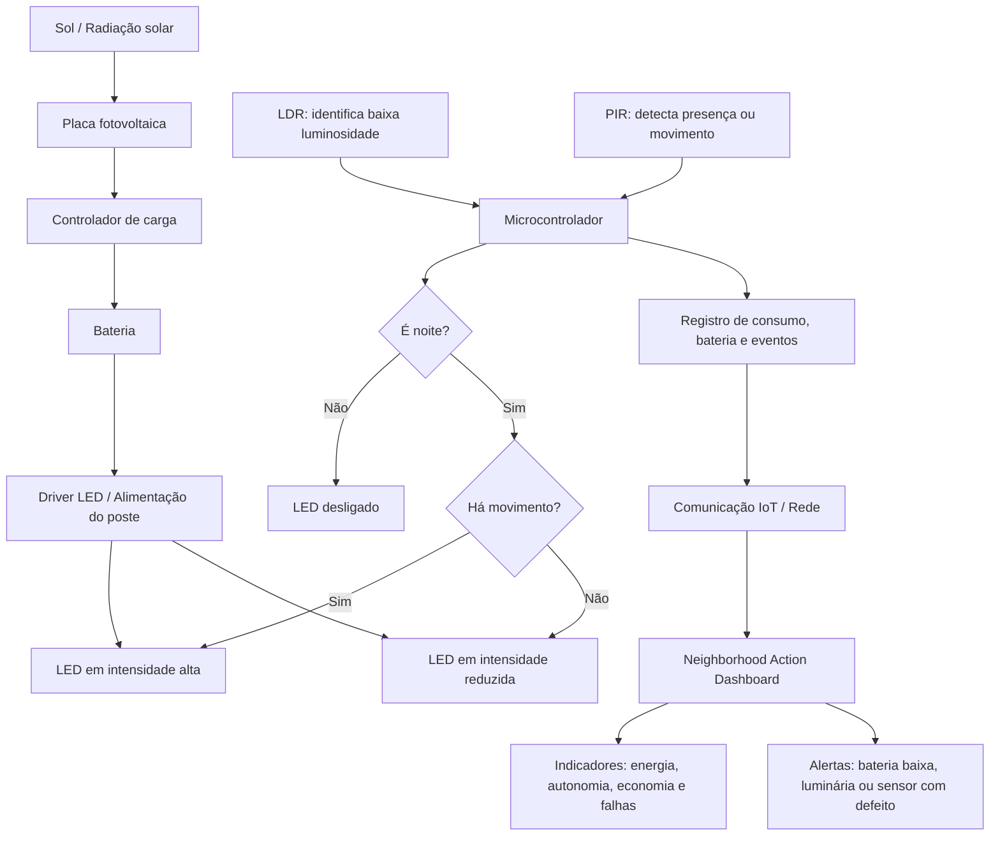

# Esquema Conceitual — Postes Solares Autônomos + LED + IoT

## Fluxo de funcionamento



## Descrição dos componentes

1. **Fonte energética:** a placa fotovoltaica converte a radiação solar em energia elétrica. O controlador de carga gerencia a energia armazenada na bateria, que alimenta o conjunto LED durante a noite.
2. **Sensores:** o LDR identifica a luminosidade ambiente e permite reconhecer o anoitecer e o amanhecer. O sensor PIR identifica movimento ou presença nas proximidades do poste.
3. **Lógica de controle:** o microcontrolador combina os dados dos sensores. Durante o dia, mantém a iluminação desligada e permite o carregamento da bateria. À noite, mantém o LED em nível reduzido e aumenta a intensidade quando o PIR detecta movimento. Após um intervalo sem detecção, retorna ao nível reduzido.
4. **Conectividade IoT:** o controlador envia periodicamente dados de estado e eventos por uma rede disponível (por exemplo, LoRaWAN ou rede celular, conforme cobertura e custo). O funcionamento local não deve depender da conexão com a internet.
5. **Dashboard:** o painel consolida consumo estimado, energia solar, nível da bateria, horas de iluminação, economia de energia da rede, disponibilidade dos postes e alertas de falha.

## Regras simplificadas de automação

```text
SE luminosidade ambiente indicar DIA:
    desligar LED
    carregar bateria com energia solar
SENÃO (NOITE):
    SE PIR detectar movimento:
        ajustar LED para intensidade alta
    SENÃO:
        manter LED em intensidade reduzida

A CADA intervalo de monitoramento:
    registrar bateria, estado do LED e eventos
    transmitir dados ao dashboard quando houver conexão
    SE falha ou bateria abaixo do limite:
        gerar alerta no dashboard
```

## Observações de projeto

- O sensor PIR deve ser configurado com tempo de retenção e sensibilidade adequados para evitar acionamentos excessivos ou falhas de detecção.
- A autonomia depende do dimensionamento do painel, bateria, controlador, consumo do LED e sequência de dias nublados.
- A conectividade pode apresentar indisponibilidade; por isso, o poste deve continuar operando de forma autônoma e armazenar dados localmente para envio posterior.
- A instalação deve priorizar pontos escuros identificados pela comunidade e respeitar níveis adequados de iluminação e segurança. A dimerização não pode comprometer a acessibilidade e a segurança dos pedestres.
